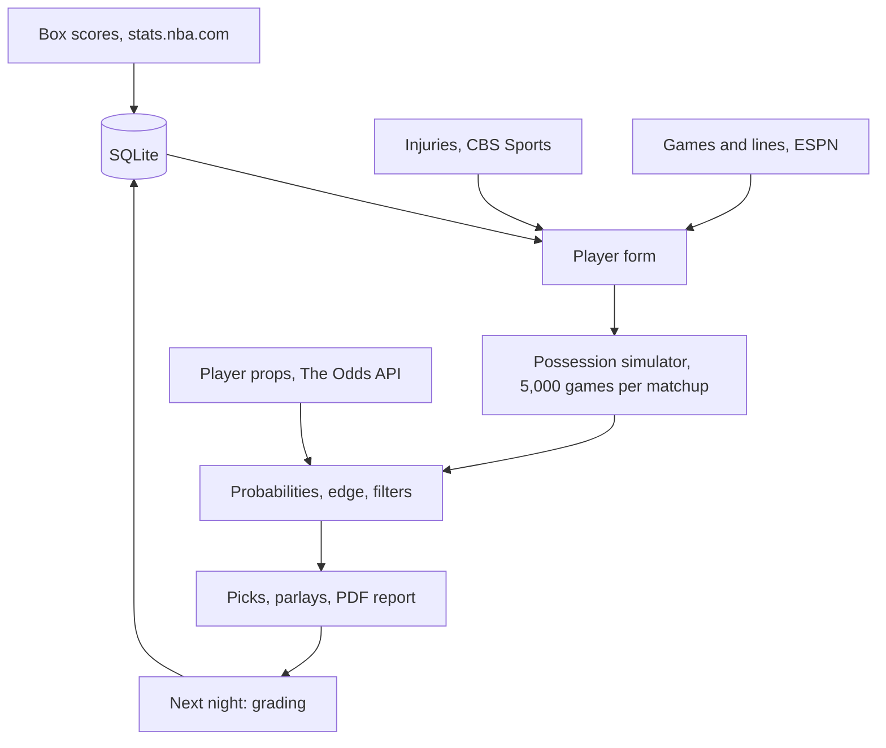

# NBA Prediction Engine

This engine simulates NBA games one possession at a time, turns the results into probabilities for player points, rebounds and assists, and compares them with bookmaker prices.

The pipeline runs on live slates. Evaluation of its picks is ongoing.

<!-- Screenshot: add docs/report_sample.png (one page of a daily PDF report) and link it here. -->

## Highlights

- Each possession is a short Markov chain (shooter, turnover or shot, make or miss, free throws, rebound). Monte Carlo plays every matchup 5,000 times and keeps the full distribution of each player's stats, so any line can be priced.
- Player form is the last 15 games, weighted toward recent ones, with shooting rates shrunk toward the league average for players with few attempts. Back-to-back and returning-player effects are fitted on 2019 to 2026 box scores.
- Raw frequencies are recalibrated into win probabilities with a logistic model tested out of sample in date order. It runs in shadow mode, logged next to every decision before it makes any.
- Every candidate is logged, rejected ones included with the reason, so each filter can be measured. Grading uses official box scores only.
- Replays of a date give the same result, and box-score ingestion can be re-run without duplicates.

## How it works



A pick's probability is the share of simulated games that clear the bookmaker's line. Its edge is that probability minus the bookmaker's implied probability (1 / decimal odds), and it must be at least 2 points. Picks also have to pass filters on the gap to the line, minutes stability and blowout risk. Up to 15 picks a day feed two parlays (2 to 3 legs, and a 4-leg "3 of 4" system) at a flat 0.2% stake.

Data comes from stats.nba.com (box scores and Synergy play-type defence), ESPN (games and DraftKings lines), The Odds API (player props), CBS Sports (injuries) and Action Network (historical lines for backtests). Rosters are kept in `database/rosters.csv`.

## Setup

Needs Linux or WSL, Python 3.14, `pdflatex`, the `sqlite3` CLI and a key from [The Odds API](https://the-odds-api.com) (about 6 credits per game per night).

```bash
git clone https://github.com/raress04/NBA-Predictor.git
cd NBA-Predictor/advanced_model
python3 -m venv ../venv && source ../venv/bin/activate
pip install nba_api pandas numpy scipy requests beautifulsoup4 nbainjuries aiohttp xgboost scikit-learn pyarrow
cp .env.example .env                     # add your Odds API key
export PYTHONPATH=.
python3 -m database.bet_tracker_schema   # tracking database
python3 -m etl.fast_backfiller           # box scores 2019-20 to 2025-26 (type YES; rebuilds the tables)
python3 -m etl.incremental_backfill      # current season
```

## Usage

```bash
bash scripts/run_pipeline.sh                                      # nightly run, before the first tip-off
python3 -m etl.live_ingestion --mode backtest --date 2026-11-10   # backtest a past date
python3 -m pytest tests -q                                        # tests
```

The nightly run grades last night's picks, simulates tonight's games, and writes a text log and a PDF report to `predictions/<season>/live_predictions/<month>/`. Monitoring reports go to `logs/<month>/`. Thresholds and switches are in `config/settings.py`; fitted parameters are in `config/*.json`.

## Project structure

```text
advanced_model/
├── etl/          ingestion, nightly run, grading, reports
├── simulator/    player form, possession engine, picks and parlays
├── ml/           monitoring, candidate logging, experimental XGBoost
├── utils/        dates, calibration, adjustments
├── config/       settings and fitted parameters
├── scripts/      run_pipeline.sh, parameter fitting, replays
└── tests/        pytest suite
```

## Roadmap

- Score the XGBoost calibration model live and compare it with the logistic one
- Let the calibrated probability drive decisions once it wins on live slates
- Use the current season's play-type defence data
- Schedule the nightly run
- Fractional Kelly staking once calibration holds up live

## Disclaimer

Research and educational project. Not betting or financial advice, and no profit is claimed. Data comes from public sources under their terms. Not affiliated with the NBA or any bookmaker.

No license yet; all rights reserved.
